<!-- MU Online style profile · generated by gen.py -->

    

  

  

> *Um Magic Gladiator do servidor Brasil: metade guerreiro do backend, metade mago do mobile. Forja sistemas em **Rails** e **PostgreSQL**, invoca apps em **React Native**, desenha interfaces no **Figma** e mantém tudo de pé nas muralhas da **AWS**. Co-fundador da guilda **DN4Code Tech Solutions**.*

## 📜 Missões ativas

| Missão | Recompensa | Status |
|:--|:--|:--:|
| 🎯 **OpinaKI** | Rede social gamificada de previsões e opiniões — [opinaki.com](https://opinaki.com) | ⚔ Em batalha |
| 🏰 **MU Online Server** | Servidor privado de MU Online, do core ao client | ⚔ Em batalha |
| 💰 **SisPag** | Sistema de pagamentos — PIX, parcelamentos e operações com USDT | ⚔ Em batalha |

## 🎒 Inventário

  
  
  
  
  
  
  
  
  
  

**🧪 Habilidades secundárias:** Hotkeys decoradas, commits atômicos, PRs com spec e um gosto suspeito por máscaras de input em centavos.

## 🛡 Chamar para a party

  
  
  
  

*“Quem não reseta, não evolui.”*

